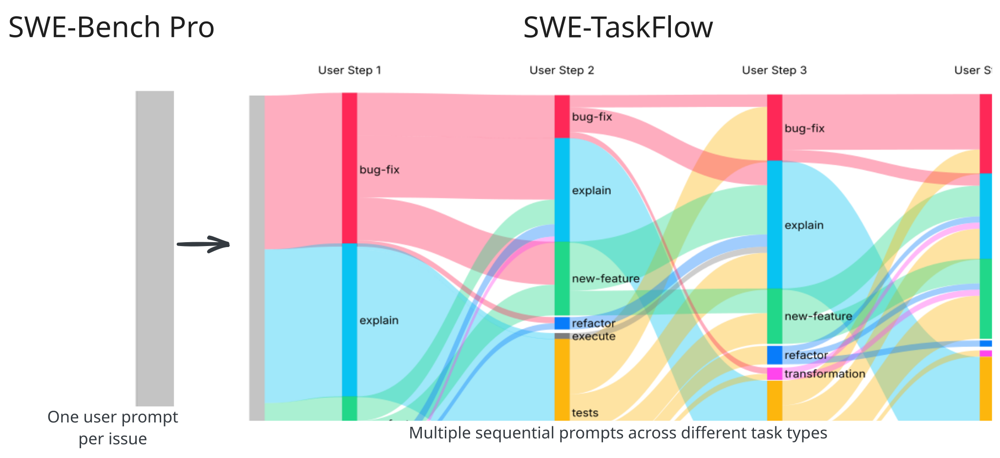
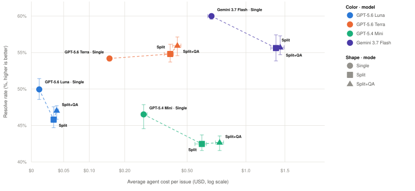
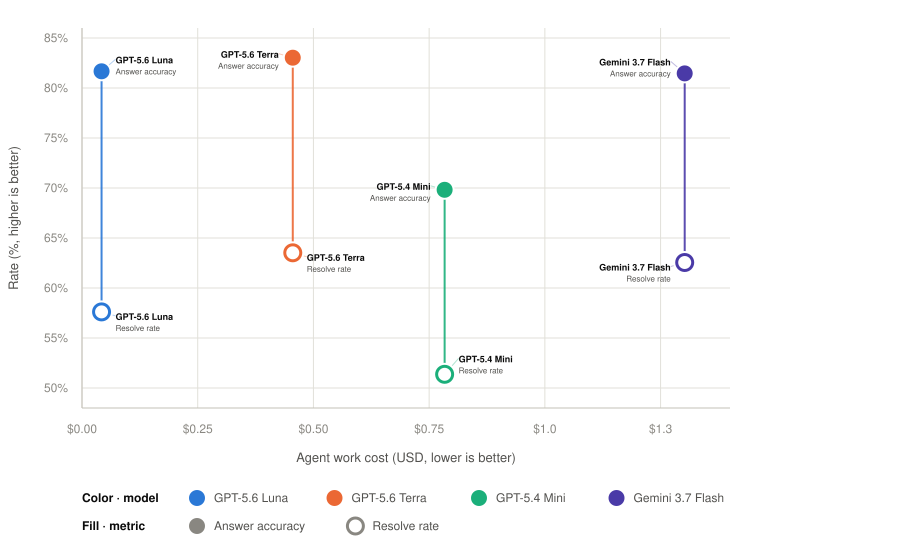
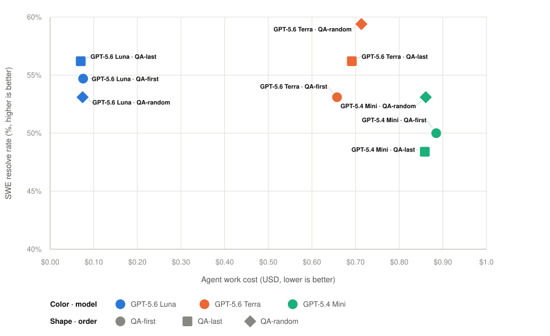
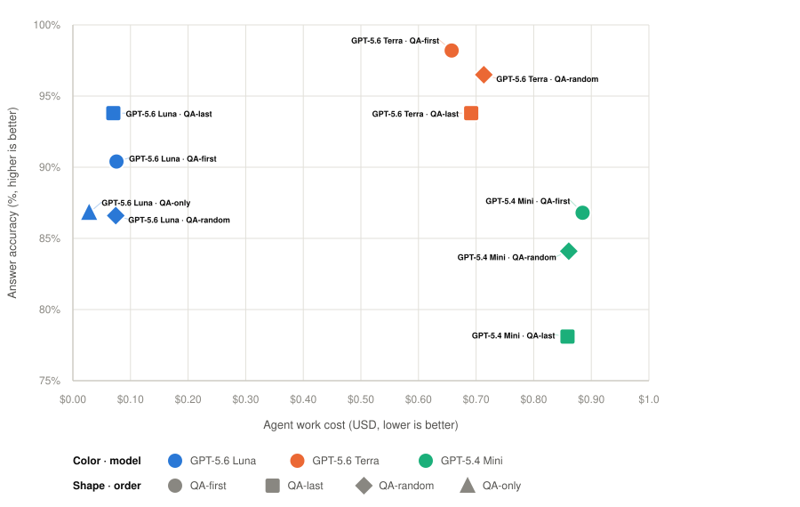
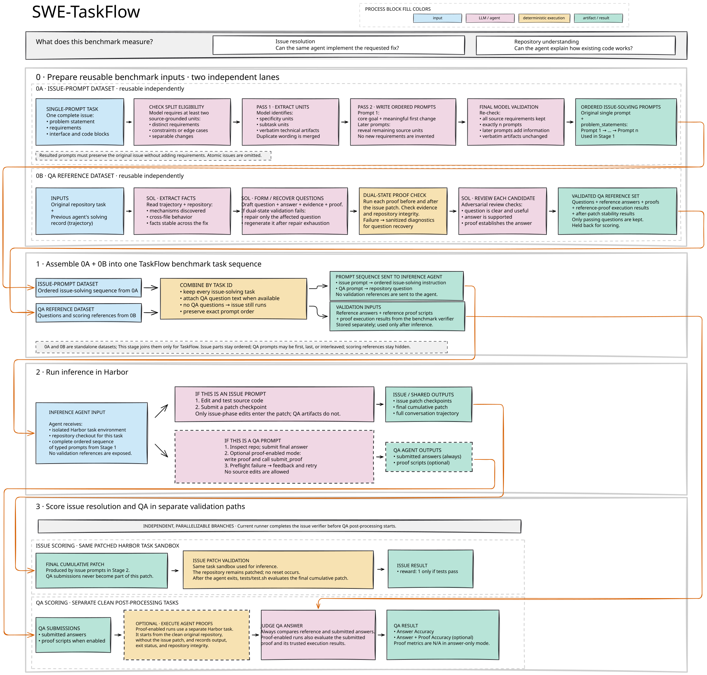

# SWE-TaskFlow Generation



Dataset generation and QA validation tooling for SWE-TaskFlow, the interactive
task-flow benchmark built on SWE-Bench Pro.

SWE-TaskFlow keeps the repositories, requested changes, environments, and
test-based verifiers of verified SWE tasks fixed and regenerates only the
interaction layer: the user messages the agent receives and their order. It
evaluates two complementary capabilities:

- Issue resolution: can the agent implement a requested repository change when
  the task is revealed progressively?
- Repository understanding: can the agent answer questions about the existing
  code, with answers checked against executable reference proofs?

The released dataset is
[`JetBrains-Research/SWE-TaskFlow-SWE-Bench-Pro`](https://huggingface.co/datasets/JetBrains-Research/SWE-TaskFlow-SWE-Bench-Pro)
on Hugging Face. Its dataset card documents the splits, the row schema, and the
evaluation protocol.

## Examples

- [Three issues, step by step](docs/taskflow-benchmark-examples.md): a
  qutebrowser and two NodeBB issues, each turned into three incremental prompts
  and paired with repository questions, reference answers, and golden proofs.
- [Pipeline walkthrough](docs/taskflow-pipeline-example.md): one qutebrowser
  task followed through every stage, with the exact prompts, intermediate
  artifacts, the agent's outputs, and the final scores.

## Contents

- [Key results](#key-results)
- [How the benchmark works](#how-the-benchmark-works)
- [Setup](#setup) and [workflow](#workflow):
  [multi-prompt records](#1-generate-multi-prompt-records),
  [QA records](#2-generate-qa-records),
  [hybrid records](#3-build-hybrid-records)
- [Prompts](prompts/): QA generation, review, repair, and judging; agent phases
- [Citation](#citation)

## Key results

### The interaction layer changes the measurement



Resolve rate versus mean agent cost per issue (log scale) on 700 SWE-Bench Pro
tasks with mini-swe-agent; markers are three-run means, whiskers min–max (not
confidence intervals). *Single* delivers the original issue in one turn,
*Split* delivers it as three ordered turns, and *Split+QA* adds
repository-question turns placed to match a measured production task flow.
Splitting roughly doubles agent cost, while resolve-rate shifts are mixed across
models and comparable to run-to-run variation.

### Every Split+QA trajectory yields two verified signals



Answer accuracy (solid) and resolve rate (hollow) for the TFAS-optimized
*Split+QA* trajectories, computed on the 255 issues that carry questions (454
questions). Answer accuracy spans 69.8–83.0% across the four models.

### Question placement does not change task difficulty

<p>
  
  
</p>

QA-first, QA-last, and QA-random placements on the same 64 tasks and 114
questions; only the order of phases differs. Neither resolve rate (left) nor
answer accuracy (right) shows a consistent ordering across models. QA-only,
which delivers the question turns without any issue turns, costs a fraction of
any mixed trajectory and still reaches 86.8% with GPT-5.6 Luna, matching its
QA-random accuracy.

## How the benchmark works



Benchmark preparation starts with two independent data-generation lanes.

- **Issue-prompt lane.** A source SWE-Bench Pro issue is classified,
  decomposed into source-grounded units, and rewritten as an ordered sequence
  of user messages. The complete sequence must preserve the original task
  without inventing requirements. Atomic issues that do not support meaningful
  incremental disclosure are omitted.
- **QA-reference lane.** An original repository task and a previous
  issue-solving trajectory are used to generate repository-understanding
  questions. Each retained question includes a reference answer, a multi-hop
  reasoning chain, and an executable golden proof that must hold both before
  and after the issue patch. Candidates pass an adversarial review and
  question-level filtering; a defect in one question does not discard valid
  sibling questions.
- **Hybrid assembly.** The two lanes are joined deterministically by task ID.
  The same inputs can be assembled as QA-first, QA-last, interleaved, issue-only,
  or QA-only prompt orders. Digests bind every record to its source task and QA
  bundle.
- **Agent execution.** The agent receives the assembled prompts in order in one
  conversation. Issue prompts allow repository edits and patch checkpoints. QA
  prompts freeze an answer and never expose validation references.
- **Scoring.** Issue resolution uses the task's verifier on the final cumulative
  patch. QA answers are judged against the hidden reference and its proof
  evidence. The two are reported separately and never collapsed into one
  scalar reward.

## Setup

```bash
uv venv
source .venv/bin/activate
uv sync --all-groups
cp .env.example .env
```

Model calls go through [LiteLLM](https://github.com/BerriAI/litellm). Set
`LITELLM_BASE_URL` and `LITELLM_API_KEY` in `.env` to point at your LiteLLM
proxy, or pass `--litellm-base-url` explicitly.

## Workflow

Multi-prompt records and QA records are generated independently:

1. `generate` converts source issue prompts into progressive multi-prompt
   records.
2. QA bundles are generated and validated per issue by an agent running inside
   the SWE-Bench Pro task container. This repository provides the prompts and
   the deterministic ingestion, validation, filtering, and evaluation steps.
3. `build-qa-multistep` joins the two inputs into hybrid records.

## 1. Generate multi-prompt records

```bash
source .venv/bin/activate
uv run swe-taskflow-generation generate \
  --preset swe-bench-pro \
  --split test \
  --shuffle-seed 917 \
  --n-parts 3 \
  --model openai/gpt-5.6-luna \
  --max-attempts 8 \
  --request-timeout 90 \
  --workers 4 \
  --output-dir outputs/swebench-pro-n3
```

The released run accepts 701 records, filters 9, and rejects 21. The command
writes a resumable checkpoint, prompt previews, debug decisions, and generation
metadata. Rerun it with `--resume` and the same options to continue an
interrupted run.

### Prompts used for single-to-multi generation

The `generate` pipeline uses three system/user prompt pairs, all defined in
[`prompts.py`](src/interactive_benchmark_generation/prompts.py):

1. Eligibility filter:
   [system prompt](src/interactive_benchmark_generation/prompts.py#L21-L23)
   and [classification prompt](src/interactive_benchmark_generation/prompts.py#L26-L72).
   The model accepts only issues containing at least two independent,
   source-grounded requirement units. Reproductions, diagnostics, repeated
   examples, restatements, and interface boilerplate do not create additional
   units. Every accepted unit must include an exact source quote.
2. Multi-prompt split generation:
   [system prompt](src/interactive_benchmark_generation/prompts.py#L3-L13)
   and [split prompt](src/interactive_benchmark_generation/prompts.py#L75-L159).
   The model first extracts specificity and subtask units, then composes exactly
   the requested number of progressive user messages. The first message states
   a meaningful core task, every later message adds new information, and the
   complete sequence preserves all source details without inventions or
   unnecessary repetition. Technical artifacts are preserved verbatim.
3. Independent LLM validation:
   [system prompt](src/interactive_benchmark_generation/prompts.py#L16-L18)
   and [validation prompt](src/interactive_benchmark_generation/prompts.py#L162-L210).
   The validator independently rechecks eligibility, progression, source
   coverage, verbatim artifact preservation, duplication, and unsupported
   additions. It returns an `ok` decision and structured issues.

Retries reuse these same prompts. Validation feedback and the previous failed
split are passed back to the split generator instead of using a separate retry
prompt.

## 2. Generate QA records

QA records require an original SWE-Bench Pro task and a valid issue-solving
trajectory for every selected issue. Generation and proof execution run as
agent tasks inside the task container, orchestrated with
[Harbor](https://github.com/harbor-framework/harbor). The orchestration
code is not part of this repository; the prompts it sends and the
deterministic steps it calls are.

Per issue, the stages are:

1. Candidate generation with the
   [QA bundle generation prompt](prompts/qa/generation.md). The model inspects
   the repository and the issue-solving trajectory and generates the requested
   number of non-overlapping, cross-file, multi-hop questions. Each question
   includes a canonical answer, evidence hops, a reasoning chain, and an
   executable golden proof that must follow the
   [golden-proof skeleton](src/interactive_benchmark_generation/templates/golden_proof_skeleton.sh).
   Questions and proofs must remain valid both before and after the issue fix.
2. Deterministic ingestion with `qa-ingest`.
3. Trusted golden-proof execution in a clean checkout, imported with
   `qa-import-golden-proof-executions`. This stage makes no model call.
4. Review with the
   [proof-aware adversarial review prompt](prompts/qa/review.md), imported with
   `qa-import-review`. The reviewer attempts to defeat every candidate and
   checks repository grounding, multi-hop necessity, reasoning validity, answer
   ambiguity, and proof quality. Trusted proof execution is authoritative, and
   behavioral claims require runtime evidence rather than static inspection
   alone. Rejected questions are dropped individually; an issue survives while
   any question does.
5. Optional repair with the
   [golden-proof repair prompt](prompts/qa/golden-proof-repair.md) when strict
   validation rejects a proof. The question and golden answer remain immutable.

Answer-agent execution, `qa-import-proof-executions`, `qa-judge` /
`qa-import-judge`, and `evaluate` belong to benchmark evaluation rather than
dataset generation. The per-phase agent prompts are in
[`prompts/agent/`](prompts/agent/) and the proof-carrying judge prompt is
[`prompts/qa/judge.md`](prompts/qa/judge.md). Run
`uv run swe-taskflow-generation --help` for the full command list.

## 3. Build hybrid records

```bash
source .venv/bin/activate
uv run swe-taskflow-generation build-qa-multistep \
  --multi-prompt-records <preview.json> \
  --qa-run-root <validated-qa-root> \
  --task-root <swe-bench-pro-task-root> \
  --output-dir outputs/<run-name>
```

Hybrid records use `qa_multistep_prompt/v1`. Their source and record hashes are
verified during construction. The protocol requires at least one prompt but
allows either kind to be absent: issue-only records contain no QA prompts, and
QA-only records contain one or more QA prompts with no issue prompts. QA-only
records still carry the validated QA bundle digest and preserve question order.

To materialize a QA row of the released dataset as an on-disk bundle and check
its hashes:

```bash
python scripts/materialize_swe_taskflow_bundle.py --row-json row.json --output bundles/
```

## Verification

```bash
source .venv/bin/activate
uv run ruff check .
uv run pytest
```

## Citation

```bibtex
@inproceedings{slinko2026swetaskflow,
  title={Opinion: Coding-Agent Benchmarks Should Match Their Users' Task Flows},
  author={Slinko, Igor and Golubev, Yaroslav and Titov, Sergey},
  booktitle={NeurIPS 2026 Workshop on Evaluation of Interactive Agents},
  year={2026}
}
```

## License

The code is released under the [Apache License 2.0](LICENSE).
